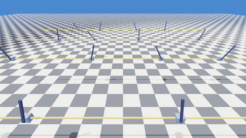
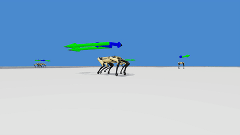
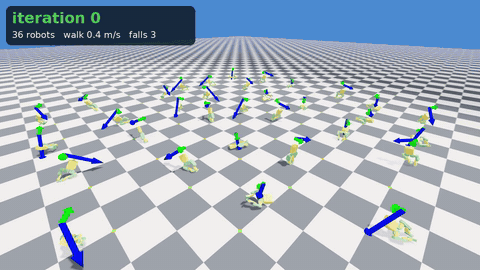
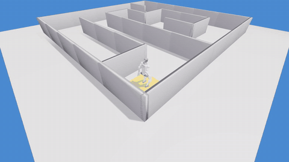
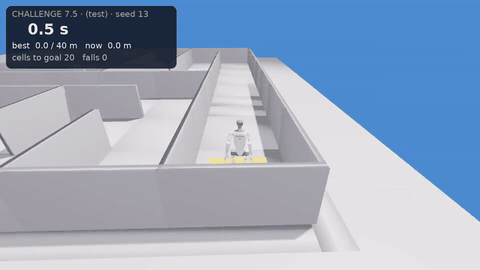
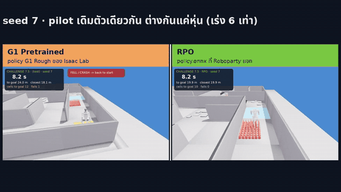

# Simulation for Humanoid — Isaac Lab 3 + Newton (7 weeks)

| Week 1 Cartpole | Week 2 Spot | Week 4 poclegs ระหว่างเทรน |
|---|---|---|
|  |  |  |
| **Week 7 Maze autopilot** | **Week 7 Hazard Maze Challenge** | **Extra: RPO vs G1** |
|  |  |  |

วิดีโอเต็ม (`*.mp4` ใน `media/` และ `videos/` ของแต่ละสัปดาห์) ไม่ได้อยู่ใน git เพื่อให้ repo เล็ก ดาวน์โหลดได้จาก [Releases](../../releases)

| Week | Topic | Slides | Code / supplementary files |
|---|---|---|---|
| 1 | Isaac Sim / Isaac Lab + Cartpole | `Week01_Cartpole/*.pdf` | Uses the tasks built into Isaac Lab (`media/` = example videos) |
| 2 | Quadrupeds: Spot / Go2 | `Week02_Quadruped/*.pdf` | Uses the tasks built into Isaac Lab (`media/` = example videos) |
| 3 | The G1 humanoid | `Week03_G1_Humanoid/*.pdf` | `code/play_interactive.py`, `code/run_onnx_policy.py` |
| 4 | Reinforcement Learning: build your own poclegs robot | `Week04_RL_poclegs/*.pdf` | `week4-supplementary-file/` (copy in step by step) · `poclegs_lab/` (finished project + checkpoints) |
| 5 | Customize the reward function (Go2 / Spot) | `Week05_Reward_Function/*.pdf` | `spot_reward_lab/` (+ `pretrained/spot_baseline/model_999.pt`) |
| 6 | Customize a humanoid robot (URDF ↔ USD, longer legs) | `Week06_Customize_Robot/*.pdf` | `week6-supplementary-file/` (4 scripts + expected_output + pretrained), continues the Week 4 project |
| 7 | Curriculum learning + G1 Maze Challenge (height scanner autopilot) | `Week07_Curriculum_Maze/*.pdf` | `g1_maze_lab/` (tasks G1-Curriculum-* / G1-Maze-* + checkpoints in `pretrained/`) |
| Extra | RPO humanoid (Roboparty) walking in Isaac Lab | — | `Extra_RPO_Walk/` (`setup.sh` clones `roboto_origin`, then `rpo_lab/`) |

เฉลยและไฟล์ของผู้สอน (`Instructor/`) ไม่ได้อยู่ใน repo นี้

## First-time setup
- You need Isaac Lab 3 and `uv`. Put this course folder anywhere you like.
- Tell the commands where Isaac Lab is installed (change the path to yours):
  ```bash
  export ISAACLAB_PATH=~/IsaacLab
  ```
- The ready-made projects (`Week04_RL_poclegs/poclegs_lab`, `Week05_Reward_Function/spot_reward_lab`) find Isaac Lab
  through a relative path in `pyproject.toml` that only works if Isaac Lab is at `~/IsaacLab` and this folder is at
  `~/Downloads/Simulation_for_Humanoid`. Otherwise run this once in the project folder, before `uv sync`:
  ```bash
  sed -i "s|\.\./\.\./\.\./\.\./IsaacLab|$ISAACLAB_PATH|g" pyproject.toml
  ```
  Projects you create yourself from the Isaac Lab template (Week 4 Step 0) already point at your Isaac Lab.
- In each project: run `uv sync` once (creates `.venv`), then use `uv run isaaclab ...`

## Tested on
RTX 3060 Laptop 6 GB · Ubuntu · Isaac Lab 3 + Newton (Oct 2026). Training times in the slides were measured on this machine.
